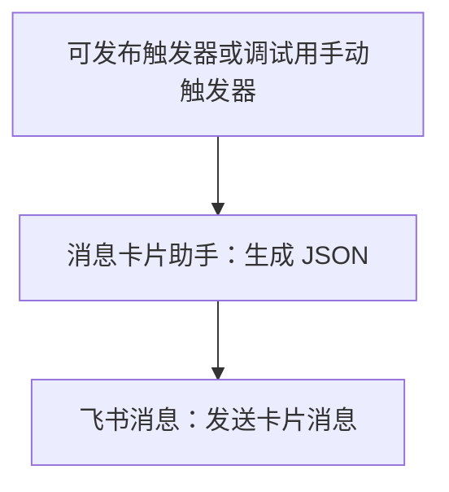
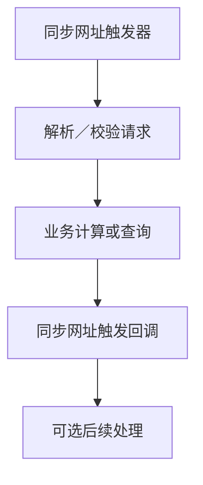
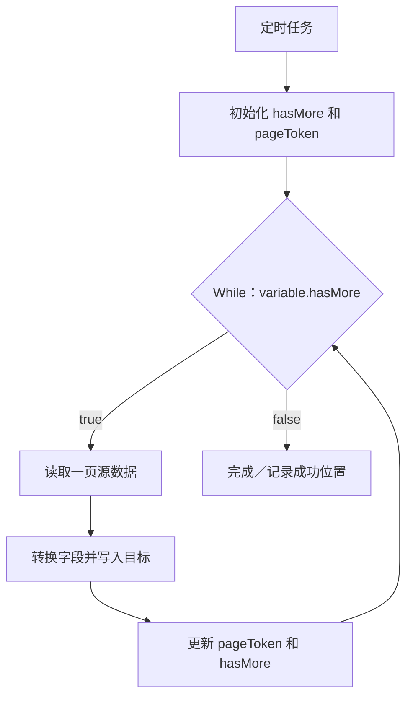

# 常用工作流搭配与操作配方

以下为依据官方能力整理的搭建配方。除明确注明的模板只读观察外，均未在平台实际创建或运行。组件 ID 和字段路径须替换为当前工作流真实值；配方本身不授权对外发送或生产写入。

## 1. 最小数据处理链路

适合在后续获准操作时熟悉节点添加、类型切换、胶囊引用和日志。开始用固定的少量数据，最后检查处理节点输出。手动触发器只供调试，不能直接发布为定时业务流程。

## 2. 组装卡片并发送

配置顺序：确认卡片模板及协作权限 → 选择卡片发布版本 → 填充变量 → 将卡片 JSON 输出映射到消息节点 → 配置凭证、接收者 ID 与 ID 类型 → 检查幂等 Key 的业务含义。

本次 HelloWorld 模板只读预览确认了这条结构，并观察到卡片权限不足提示。卡片助手不会自行发送消息；消息连接器版本和卡片模板发布版本是两个独立版本。

## 3. 同步 Webhook 返回结果

在触发器中配置同步等待时间，在回调中配置状态、内容及 Header。版本 1.3 及以后回调 `flow_key` 自动填充；不要照旧教程重复手填。回调内容不超过 256 KB。

等待超时后后台流程仍可能执行；回调返回后后续节点也可能执行。调用方重发前应有业务去重策略。需要明确区分“已收到请求”“业务已完成”和“后台处理中”的响应语义，不能提前返回业务完成却让关键写入留在回调之后。

## 4. 定时分页同步到多维表格

建议先用串行方式确认字段结构，再根据真实吞吐需求决定是否并行。

| 节点 | 必须配置 | 核对内容 |
|---|---|---|
| 定时任务 | 时区、周期、触发时间、生效期 | 不同周期字段不同；触发频率与一次耗时匹配 |
| 设置变量 | `hasMore=true`；初始游标按接口规则留空或设值 | 未输入与空字符串可能不同 |
| While | `variable.hasMore`；合理最大次数 | 读取最新变量，不引用初始化节点的旧出参 |
| 读取一页 | 过滤条件、分页大小和当前游标 | 找到真实列表字段与下一页标记 |
| 字段转换 | 源字段到目标字段的名称及类型映射 | ID、日期、人员、附件等不能一律当字符串 |
| 写入目标 | 匹配业务键、创建或更新操作 | 防止重复创建；批量失败是否部分成功以接口为准 |
| 更新变量 | 使用本页返回的游标与 hasMore | 本页业务失败时不能盲目推进成功游标 |

数据库没有统一的分页语法，应按 MySQL／SQL Server／Oracle／PostgreSQL 的实际接口和 SQL 方言配置。若源数据会持续变化，排序键和增量边界需由业务定义；不能把偏移分页自然视为可靠增量同步。

**实例：无限触发的增量同步，断了自动拉起（2026-11-12 搭好并通过校验，两轮独立审核；取数、查表筛选、读驾驶舱只读实跑过，批量写还没在正式表上跑过）**

无限触发的意思是：一轮跑完，插一段缓冲，再调自己开始下一轮。节奏跟着实际运行时长走，一轮跑多久都行。固定节拍的做法被用户否掉了，例如由一条流程每 15 分钟叫一次同步。原因是一轮比一拍长时，两轮会叠在一起跑。

老做法是一条网址触发的流程，每次运行只做一页：

- 满页就马上调自己的回调地址，带上下一页的页码。
- 最后一页先写更新日志，再同步调用「延迟 10 分钟」子流程，然后调自己，从第一页开始新一轮。
- 接口取不到时，同步调用「延迟 1 分钟」子流程，再重新取。

老做法有两个毛病（实测，32 天运行日志）：

- 中间失败一次链就断了，要人去重启。两次各断了 16～17 小时：一次是鉴权请求连接超时，这一步没有「等 1 分钟再试」；另一次是接口回了空列表，计数节点报错。
- 每轮都把最近 48 小时变动过的数据全部重写一遍。

改进后，每种数据一条「无限同步」流程，用网址触发：

1. **对接力号。**每一棒把「接力号」和「第几棒」放在网址参数里传给下一棒，并记进数据存储。拉起时换一个新的接力号，从第 1 棒开始。老链的下一棒进来对不上号，就直接结束，这样同时只会有一条链在跑。手动点调试不带接力号，只跑一棒，不接着跑。
2. **只取有变动的。**从数据存储读出「上次同步到」，取它和「现在往回 N 小时」中更早的那个之后有变动的（N 照老流程，每轮至少把这段重写一遍）。一棒最多做 30 页，剩下的马上调自己接着做，页码和时间段放在网址参数里带过去。
3. **取不到先等。**连接器步骤的错误处理选「重试，还失败走分支」，出错分支里只记一个「这次出错了」的流程变量。后面用脚本判断取没取到：没出错、业务码是 0、回的正是这一页、记录是列表才算。没取到就同步调用「等 1 分钟」子流程，外面套一个 While，最多取 30 次。30 次都不行，用脚本报错，让这一棒失败。
4. **一页一起写。**一页 50 条先用脚本整理成行、按业务键去重，用「查询记录」一次查出表里已有的（筛选条件整个用表达式），分成更新和新增两组，各用一次批量写。写完核对写回的行数。没写成等 1 分钟，先查再分再写，最多 10 次；批量新增出错不在节点上重试，免得飞书其实写进了又重发一遍。
5. **一轮做完才推进。**全部成功后，把「上次同步到」改成「这一轮开始时间减 5 分钟」，写回数据存储。中间失败就不推进，拉起后从原位置重做。写表是「有就更新」，重做不会出重复行。
6. **歇一会儿再开下一轮。**一轮做完，同步调用「等 10 分钟」子流程，再调自己开新一轮。没做完的不歇，马上接着做。
7. **全量重刷不另起一条链。**把「从第几页开始」记进数据存储，每棒做几页，做完马上接着做。每隔 10 分钟插一轮增量，免得新数据被耽误；增量一轮做完，下一棒一定轮回全量，免得增量一轮超过 10 分钟时全量永远轮不到。

链断了，分两种情况拉起来：

- **失败了（有失败记录）：**告警流程计数。前两次马上调它的网址，换新接力号拉起来；第 3 次只提醒，不再拉。
- **静默停了（没有失败记录）：**交给一条每小时跑一次的定时「看门」流程。它读各条链记下的「最晚」时间，过了还没有下一棒，或者从没跑过，就换新接力号拉起来。看门只看、不跑同步。拉不起来时，它下个小时再试，正好当退避。
- **拉了也不动：**看门顺带读各条的「上次同步到」，超过 3 小时没往前走、驾驶舱里也没暂停的，看门直接发卡片提醒，不经过告警流程，告警流程自己坏了也收得到。它记下提醒过哪几条、当时的「上次同步到」是多少，同一次卡住只提醒一次，恢复了自动去掉。卡片重试后还发不出去，就让看门这一次失败、不记「提醒过」，下个小时再发。链拉不起来、卡在同一页反复失败、等待子流程坏了，最后都会表现成这个。
- **看门自己也会停：**定时触发器发布满两年到期，到期后悄悄停跑；这个租户里也见过定时流程悄悄停了七八天（实测）。看门每次一开头把「现在」记进数据存储当心跳。「等 10 分钟」每次开头看一眼，超过 3 小时没有新心跳就发卡片提醒，同一次停跑只提醒一次。这几个节点出错一律照常往下等，不能拖累链。

要注意这几点：

- **节点上限：**平台限制一次运行最多 4 万个节点。逐条写时每条记录大约要 10 个节点，每棒的页数要定小；改成一页一起写后，每页二三十个节点，和条数无关。同步调用的子流程，节点也算进主流程（文档）。
- **「最晚」要勤刷：**每次取数、每次写表之前都把接力的「最晚」往后推。只在每页开头推的话，一页重试久了（取 30 次加写 10 次），看门会在老棒还在跑时拉起新链。
- **等待：**单个延迟节点最长 3 秒。等待子流程照抄老流程：每圈等 2.6 秒，用 `$.while-1.index` 数圈数，够数了用「终止」结束。等 10 分钟约 200 圈。
- **等待失败别放过：**「等 10 分钟」调不成或秒回时，要让这一棒失败，否则链会不歇气地一直跑，等于高频轮询。做法：收尾时记下时刻，等完再用脚本看过了几分钟，不到 8 分钟就报错（老的「延迟 10 分钟」实际每次 9～10 分钟）。
- **计数清零放最后，而且只在一整轮做完时清：**告警用的「连续失败」要在调自己成功之后清零。放在开头清，每次失败都只记成 1，永远到不了 3。每棒成功都清也不行：一轮要分几棒做、坏在第 2 棒以后时，第 1 棒成功就把计数清了，告警一直拉起、永远不提醒。（本机模拟，2026-11-12）
- **被顶替的旧棒要自己停：**看门或告警拉起新链时，老链不一定死了，可能只是慢，两条会同时写表。每一棒在接力记录里带一个随机「标记」。每次取数、写表前推「最晚」时，先读一下接力记录：已经换成别的接力号或别的标记，就走「结束」节点停下，不再写表，也不改接力记录。「结束」节点的运行状态是成功，不触发告警（实测：老「延迟 10 分钟」4456 次运行全是成功）。本机随机交错模拟 2 万次，最后总是只剩一条链，最多多写两三页；写表是「有就更新」，多写不出错。
- **一棒要限时：**一次运行最长 4 小时、最多 4 万个节点，同步调用的子流程也算在里面（文档）。一棒取页超过 40 分钟就不再取新页，把进度交给下一棒。按最坏情况（每页取 30 次、写 10 次）估过，一棒约 2.6 万个节点、约 100 分钟。（本机估算）
- **限流和写冲突不算坏数据：**多维表格回这几个错误码是一时的，等一下再试就好：1254036（多维表格在复制）、1254290（请求太频繁）、1254291（写冲突）、1254607（数据还没准备好）、1254608（重复提交），还有开放平台的 99991400（限流）（文档）。碰到它们等 1 分钟原样再写，批量写连着 5 次都这样才改成一条条写，一条条写时也不把它们当坏数据跳过。只有别的错误（例如字段值不对）才跳过那一行并提醒。
- **按 ID 刷新要核对 ID：**列表接口的 ID 筛选是可选的，ID 为空时会回全部第 1 页。只看「取到了没有」，会把表里这一行改成别的记录。要核对取回来第一条的 ID 和要刷新的一样。

## 5. CSV 文件读取与入库

文件 URL → 文件助手转换为平台文件 → CSV 解析 → 保存本次 `csvFileId` → While 分页读取 → 映射表头与字段 → 目标写入 → 更新游标。

CSV 解析标识不能跨工作流、跨项目或传入子流程使用。需要子流程处理时，应传当前页普通数据，而不是解析标识。读取前确认编码、分隔符、注释行和表头处理。分页默认大小为 100；用 `hasMore/pageToken` 继续读取。

## 6. 根据业务状态路由

触发事件 → 读取详情 → 分支判断状态 → 分别执行通过、拒绝或未知状态处理。

只有一个路径应该执行时选择互斥分支；多个独立条件都需要产生结果时选择广播。互斥分支把更具体的条件放在可能覆盖它的宽条件之前。默认分支用于未命中的情况，不等于接口失败处理；接口失败应由错误处理规则处理。

广播的实际并行／顺序语义存在官方文档冲突，因此不能用广播构造“先写 A，保证成功后写 B”这种依赖链。该依赖应放在同一路径中串联。

## 7. 子流程复用

主流程准备输入 → 调用子流程 → 子流程触发器接收入参 → 公共处理 → 子流程响应 → 主流程消费结果。

同步调用适合依赖返回结果的逻辑；异步调用适合不等待结果的独立处理。最大三层嵌套；子流程执行节点计入主流程一次运行节点总量。主／子流程的入参契约应明确必填、类型、默认值、结果和失败表现。

跨工作流依赖的配置、凭证、数据集合及文件有效期不能靠复制流程自动解决。CSV 解析标识有明确禁止跨子流程限制。

## 8. 告警通知

Prometheus／Grafana／Jenkins／告警触发器 → 提取事件字段 → 分支过滤 → 卡片格式化 → 飞书消息。

先确认所选组件是事件接收入口还是普通动作。检查来源系统回调配置、事件重复、告警恢复通知和接收对象；官方资料中的设置按钮是说明，当前只读阶段没有配置任何真实回调或发送通知。

**实例：连续失败 3 次才提醒，而且只提醒一次（2026-11-12 搭好并通过校验，还没实际跑过）**

- 告警触发器每失败一次就触发一次。所以在告警流程里，先用数据存储给每条流程计数（键用流程名），每触发一次加一。
- 计数刚好等于 3 时，才发卡片。
- 被盯着的流程每成功跑完一次，就在最后一步把这个计数清零。这样一直失败只会提醒一次，恢复以后再坏，还会再提醒一次。

## 9. 接口失败的处理配方

查询接口可以按错误性质选择有限重试；认证失败应处理凭证或权限；参数错误应修正映射；写接口超时应先核对目标状态。失败分支应保留足够的业务键和错误描述供排查，但不在日志或消息中复制密钥。

流程如果忽略了非关键失败，最终结果应能区分“全部完成”和“部分完成”。平台允许继续运行，不代表业务可以无条件把它标为成功。

## 10. AI 工作流

触发器提供文本／文件 → 标准化输入 → 选择对应模型服务操作 → 解析响应 → 业务规则判断 → 后续处理。

如选择的是创建生成任务，需按操作目录继续查询任务状态和结果；不能直接把任务 ID 当成最终内容。结构化输出需检查字段和类型，不直接将模型生成文本当作可执行 SQL、脚本或下一步指令。

模型名称、推理接入点、凭证、额度及异步能力按各组件手册和当前界面配置。AI 分类只有部分模型连接器；飞书 Aily、飞书 AI 及业务分类中的 Moonshot 也与 AI 有关，任务索引会交叉列出。

## 11. 一次配方完成的判断

画布结构正确只是配置证据；关键节点 Input／Output 正确是运行证据；目标系统实际变化正确才是业务结果证据。后续只对本次目标所需入口做相称验证，保留必要日志或脱敏样例，避免反复全量重跑。
